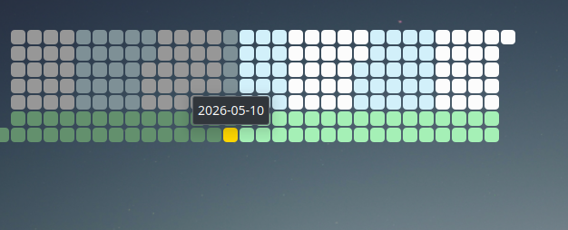

# Daytiles

A KDE Plasma 5 and 6 desktop widget that renders a [daytiles](https://github.com/Chamartin3/daytiles) calendar — a compact grid where every day is a tile you can color, highlight, and click. Useful for tracking events, habits, deadlines, or any per-day signal at a glance.

Supports **Plasma 6** (`package/`) and **Plasma 5.27** (`package-plasma5/`). Each release ships a `.plasmoid` for both.



## Features

- Month, week, weekday, and custom range layouts.
- Per-event types with custom colors; events stored in the widget config.
- Quick-add panel for new events; click a tile to see that day's events.
- Configurable tile size, gap, fade, weekend highlights, heatmap range, and a tooltip date format.
- Highlight rules form for arbitrary day-of-week or date-pattern coloring.
- Compact representation for panel mode.

## Install

```sh
kpackagetool6 -t Plasma/Applet --install package/          # Plasma 6
kpackagetool5 -t Plasma/Applet --install package-plasma5/  # Plasma 5
```

To upgrade an already-installed copy:

```sh
kpackagetool6 -t Plasma/Applet --upgrade package/
kpackagetool5 -t Plasma/Applet --upgrade package-plasma5/
```

Or use the Makefile:

```sh
make install      # install
make upgrade      # install or upgrade
make run          # upgrade + open in plasmoidviewer
make package      # build both .plasmoid bundles
make uninstall    # remove

# Plasma 5: append PKG=package-plasma5 KPT=kpackagetool5
```

## Repo layout

- `package/` — the Plasma 6 plasmoid (`metadata.json`, `contents/ui`, `contents/config`).
- `package-plasma5/` — the Plasma 5 plasmoid; keep its `.js` files and `main.xml` in sync with `package/`.
- `vendor/daytiles/` — pinned build of the upstream library.
- `assets/screenshots/` — screenshots used by this README.
